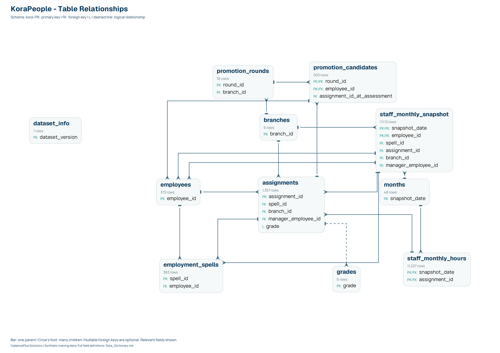
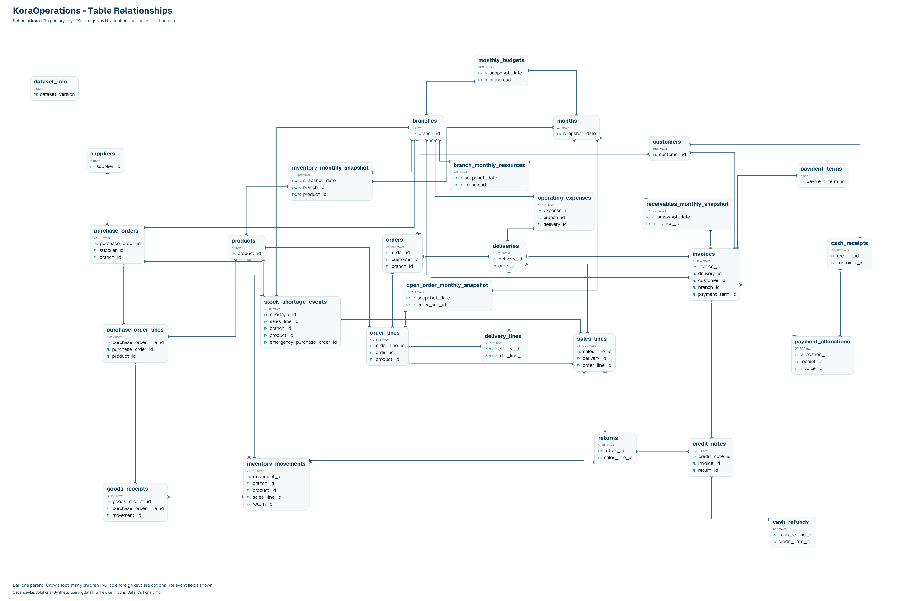
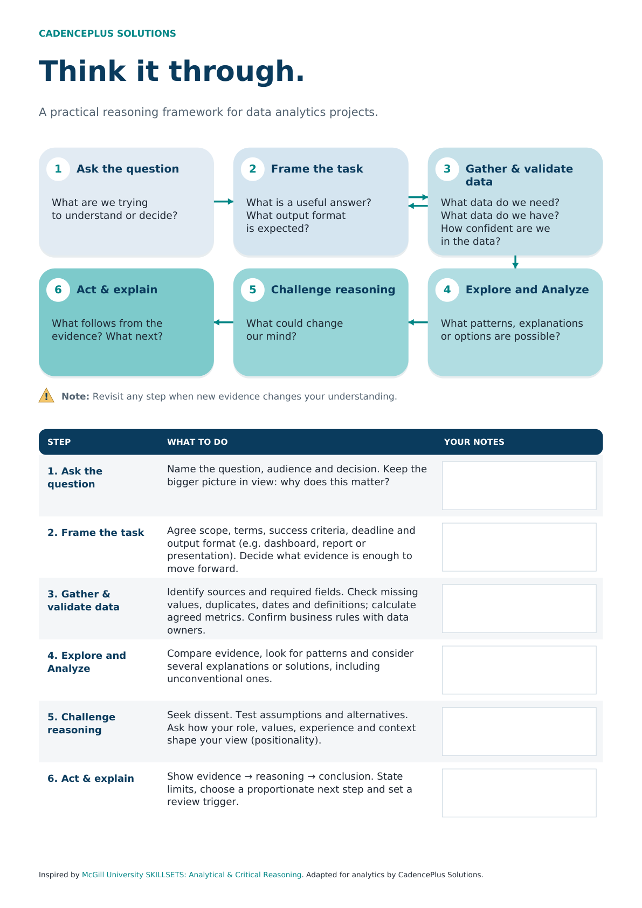

<!-- page break -->

# Kora Workplace Supply Ltd. - Free Project Pack

Analyze Financial, People and Operations data

Kora Workplace Supply Ltd. is a fictional Nigerian supplier. This free pack contains two related reporting databases, 40 tables, 630,743 records and three project guides covering four years of business activity. It is free to use for learning.

In this pack you will:

• Load the two reporting databases using your chosen engine and the Database Setup Guide.

• Pick one of the two business problems in each project.

• Build reusable views and stored procedures, validate your measures and explain what the evidence supports.

## Your project guides

Kora Financial Analysis - Free Project Guide: profitability, budgets, receivables and collections.

Kora People Analysis - Free Project Guide: retention, workforce movement and progression opportunities.

Kora Operations - Free Project Guide: branch service, capacity, inventory and replenishment.

The projects progress from financial reconciliation to effective-dated people analysis and then to operational decisions under resource constraints. Use the "Think it Through" framework; it is included in this guide.

<!-- page break -->

# Understanding the data

Kora Workplace Supply Ltd. supplies workplace technology, furniture and business supplies to fictional organizations in Nigeria. This extract covers 1 January 2022 to 31 December 2025, with reporting snapshots at all 48 month ends. Monetary values are in NGN and exclude tax.

## Two reporting databases

Operations and Financials (SQL database: KoraOperations) contains customer orders, deliveries, sales, returns, procurement, inventory, operating expenses, budgets and receivables. It supports both the financial and operations projects.

People (SQL database: KoraPeople) contains employees, employment spells, assignment history, monthly workforce records and promotion assessments. It supports the people project.

Both databases use the kora schema.

## Events, histories and snapshots

Event tables describe what happened and when. Effective-dated histories describe a state over an interval. Monthly snapshots describe balances or populations at month end. Use the appropriate date for your question; do not add headcount, stock or receivables balances across months.

The data includes earlier employment history where needed to establish opening populations. Open histories run through the dataset cutoff of 31 December 2025. Use that cutoff, not the date on your computer.

## How this relates to Kora Starter

This is a separate four-year synthetic edition. Its 2025 records are not an extension of, or a reconciliation to, the Kora Starter dataset. Do not append this extract to the starter database.

## Table details and full definitions

The following pages explain what each table represents.

For field definitions, data types, keys, missing values and detailed join examples, use Reference/Data_Dictionary.md or Data_Dictionary.csv. The schemas are included after the table summaries; Relationships.csv provides the complete relationship list.

## Shared reference tables

These three tables appear in BOTH KoraOperations and KoraPeople. The copies use matching branch IDs and reporting months.

- **dataset_info**: One row defining the reporting window and version.

- **months**: One row per month end; 48 reporting periods.

- **branches**: One row per distribution centre; same IDs in both databases.

<!-- page break -->

# Table details

## Operations and Financials: customers and sales

SQL database: KoraOperations · Schema: kora

- **customers**: One fictional organization; includes customers with no orders.

- **products**: One product; standard unit cost is fixed in this teaching model.

- **orders**: One order; standard work hours reflect its handling complexity, not actual labour.

- **order_lines**: One product line per order; net value excludes tax and includes cancelled demand.

- **deliveries**: One consignment; split orders have several. Unresolved shipments have no delivery date.

- **delivery_lines**: One delivered order line in a consignment; only completed deliveries have rows.

- **sales_lines**: One invoiced delivered line; this teaching model invoices at completed delivery, excluding tax.

- **returns**: One full or partial return of an invoiced line; recovery only for restocked units.

<!-- page break -->

# Table details

## Operations and Financials: finance

SQL database: KoraOperations · Schema: kora

- **payment_terms**: One payment term; copied to each invoice at issue.

- **invoices**: One invoice per completed delivery; amount equals its sales lines, excluding tax.

- **credit_notes**: One recognized sales credit per return; a credit is not itself a cash refund.

- **cash_receipts**: One customer cash receipt; all receipts fully allocated in this teaching extract.

- **payment_allocations**: One receipt allocation to an invoice; a receipt may settle several invoices.

- **cash_refunds**: One cash repayment of a customer credit balance; decreases cash and increases net receivables.

- **operating_expenses**: One recognized branch expense component; fixed costs, overtime and shipping, excluding goods, tax, interest and capital expenditure.

- **monthly_budgets**: One approved branch budget for a month; frozen planning assumptions, not fitted actuals.

- **receivables_monthly_snapshot**: One nonzero invoice balance at month end; negative balances are customer credits, not overdue debt.

<!-- page break -->

# Table details

## Operations and Financials: inventory and resources

SQL database: KoraOperations · Schema: kora

- **suppliers**: One fictional supplier with standard planning lead time.

- **purchase_orders**: One supplier purchase order; Standard or Emergency. Some remain outstanding at cutoff.

- **purchase_order_lines**: One product line on a supplier order; current extract uses one line per purchase order.

- **goods_receipts**: One receipt against a purchase line; partial receipts are possible.

- **inventory_movements**: One stock movement; opening balances on 1 January 2022 plus receipts sales returns and adjustments.

- **inventory_monthly_snapshot**: One product at one branch at month end; balances are not additive across months.

- **stock_shortage_events**: One failed stock check immediately before fulfilment; same-day emergency procurement supplies the shortage. Not a duration measure or proof of the cause of delivery lateness.

- **open_order_monthly_snapshot**: One unfulfilled noncancelled order line at month end; completed lines are absent.

- **branch_monthly_resources**: One branch month; period flows despite month-end date. Hours reconcile to non-manager HR hours; costs exclude goods shipping and refunds.

<!-- page break -->

# Table details

## People: workforce and progression

SQL database: KoraPeople · Schema: kora

- **employees**: One row per person; names are synthetic labels and persist across rehires.

- **employment_spells**: One continuous employment period; rehire creates a new spell.

- **assignments**: One effective-dated branch role manager and pay assignment within an employment spell.

- **staff_monthly_snapshot**: One active employee at each month end; terminated employees disappear after their exclusive termination date.

- **staff_monthly_hours**: One assignment active for any part of a month; hours prorated by weekdays including midmonth hires and leavers.

- **grades**: One internal responsibility band; promotions may retain the same job family title.

- **promotion_rounds**: One branch promotion round; frozen eligibility and scores precede the decision.

- **promotion_candidates**: One eligible considered employee in a round; includes non-selected employees and missing scores.

<!-- page break -->
# KoraPeople - Table Relationships

<!-- page break -->
# KoraOperations - Table Relationships

<!-- page break -->
# Think It Through

Use the original [Think It Through template](../Reference/Think-It-Through-Template.pdf). The framework is reproduced unchanged below.

<!-- page break -->

# Kora Financial Analysis - Free Project Guide

Use the SQL objects required for the chosen case. SQL Server and MySQL support stored procedures; PostgreSQL can use a parameterized function. SQLite has no stored procedures: submit a reusable view and a saved parameterized query with equivalent output. SQL Server and PostgreSQL use the kora schema; MySQL and SQLite use tables in the selected database without that prefix.

## Business problem A

## The decision

Sales are growing, but is profit keeping up?

The Finance Manager must decide where to protect branch profitability in the next quarter.

You are required to assess whether sales growth is translating into gross profit and operating contribution, then recommend two financially justified actions.

## Your data

KoraOperations: sales_lines, returns, order_lines, orders, products, customers, operating_expenses, monthly_budgets, months and branches. Invoices provide a reconciliation to recognized sales.

## Possible questions

1. Build monthly and annual revenue, gross-profit and operating-contribution trends for all 48 months. Compare the same months across years, then calculate actual-versus-budget variances for net sales, goods costs, operating expenses and operating contribution.

2. What drives the changes? Distinguish total contribution from margin rates. Keep branch overhead separate unless you justify an allocation.

3. Quantify discounts and returns. Does a branch-level result persist within comparable categories and customer segments?

4. Which expense components explain budget variances? Check that shipping and resource-table costs are not counted twice.

5. Test an alternative explanation for the strongest finding. Separate what the data quantifies from what it cannot establish.

6. Recommend at least two actions, with the value at stake, a responsible stakeholder, assumptions and review measures.

## Think It Through

Challenge reasoning: does the profitability story survive a change in category mix? Act & explain: quantify a defensible action rather than simply asking finance to investigate the same data.

<!-- page break -->

## Main measures

Net sales for a period = sales_lines.sales_value_ngn on sale_date minus return credits on return_date. returns.refund_ngn and credit_notes.credit_amount_ngn record the same credit; subtract it only once.

Net goods cost for a period = sales_lines.cost_of_goods_ngn on sale_date minus returns.recovered_cost_ngn on return_date. Gross profit = net sales minus net goods cost.

Gross margin = total gross profit divided by total net sales for the same population and period. Return NULL when net sales are zero; do not average individual margin percentages.

Operating contribution = gross profit minus recorded operating_expenses. This is not audited company net profit; tax, interest, depreciation and complete corporate accounts are absent.

Budget variance = actual amount minus budget amount for the same branch and month. A positive sales variance differs from a positive cost variance. Budget contribution = budget net sales minus budget goods cost minus budget operating expenses.

## Required SQL objects

Create kora.vw_MonthlyFinancial: one row per branch-month, including zero activity. Return invoiced sales, credits, net sales, net goods cost, gross profit, operating expenses, contribution, budgets and variances.

Create kora.usp_FinancialSummary(@StartDate, @EndDate, @BranchID = NULL). Return monthly financial measures and gross margin, ordered by month and branch. Require complete months within 2022-2025; reject missing/reversed dates and unknown branches.

<!-- page break -->

## Business problem B

## The decision

We made the sales. Where is the cash?

The Credit Control Manager needs a collection priority list and a review of payment terms. Identify the customers and invoices driving overdue balances and recommend targeted actions without treating every unpaid invoice as overdue.

## Your data

KoraOperations: invoices, payment_terms, credit_notes, cash_receipts, payment_allocations, cash_refunds, receivables_monthly_snapshot, customers, branches and months.

## Possible questions

1. Reconstruct balances at selected historical month ends and compare with supplied receivables snapshots. Keep not-yet-due balances and customer credits visible.

2. How do overdue amount, overdue share and aging change over four years? Separate growth in sales from deterioration in payment behaviour.

3. Which customers account for the greatest overdue exposure? Compare amounts, age, payment history and concentration; do not choose an arbitrary top five.

4. How do partial payments, contractual terms and later return credits change the interpretation? Use only events known through the reporting date.

5. Compare customers with similar terms. Distinguish invoices still awaiting payment from fully observed payment histories.

6. Recommend at least two collection or terms-review priorities. Quantify exposure and propose measures to review progress.

## Think It Through

Gather & validate data: prove your date filters prevent future payments from rewriting earlier balances. Challenge reasoning: does a large unpaid balance reflect delinquency or simply longer agreed terms?

<!-- page break -->

## Main measures

For each invoice, calculate its balance at the reporting date: original amount minus credits issued and payments allocated by that date, plus any related cash refunds paid by that date. A negative balance is a customer credit.

Add positive invoice balances to report receivables. Show negative invoice balances separately as amounts owed to customers; do not offset them against overdue positive balances.

For a positive invoice balance, days past due is zero through its due date; after that, count the days from due_date to reporting date. Use not overdue, 1-30, 31-60, 61-90 and over 90 days as buckets.

Overdue share = positive overdue balances / all positive balances at the same date. Receivables are balances and must not be summed across months.

Customer net cash for a period = receipts on receipt_date minus refunds on refund_date. This is not company cash flow: supplier and staff payments are absent. The extract has no opening receivables from before 2022.

## Required SQL objects

Create kora.usp_ReceivablesAging(@AsOfDate, @BranchID = NULL). Return invoice, customer, branch, invoice and due dates, balance, days past due and aging bucket. Support any date within 2022-2025, including non-month-end dates.

Exclude settled invoices, preserve customer credit rows and reject NULL/out-of-window dates or unknown branches. Aggregate allocations, credits and cash refunds separately before joining invoices.

<!-- page break -->

# Submission

## Expected deliverables

Pick one business problem. Submit one reproducible SQL file containing analysis queries, the reusable objects required for your chosen problem, readable aliases, explanatory comments and executable validation tests.

One report page in a BI tool of your choice, with clear labels. Supply the editable report and a PDF or image export. *EVERY VISUAL SHOULD HAVE A JOB.*

One recommendation page with at least two actions, supporting numbers, reasoning, limitations, responsible stakeholders and proposed follow-up measures.

One methodology page organized around the Think It Through Framework. Explain any definitions you developed for metrics beyond those provided in the project guide, your quality checks, assumptions and limitations.

<!-- page break -->

# Kora People Analysis - Free Project Guide

Use the SQL objects required for the chosen case. SQL Server and MySQL support stored procedures; PostgreSQL can use a parameterized function. SQLite has no stored procedures: submit a reusable view and a saved parameterized query with equivalent output. SQL Server and PostgreSQL use the kora schema; MySQL and SQLite use tables in the selected database without that prefix.

## Business problem A

## The decision

Why are people leaving?

The People Manager wants a focused retention plan. Determine where departures represent a sustained concern, how hiring offsets them and which recorded explanations warrant action. These fictional records describe no real workplace.

## Your data

KoraPeople: employees, employment_spells, assignments, staff_monthly_snapshot, staff_monthly_hours, grades, branches and months. Exit events remain in spells even after employees disappear from active snapshots.

## Possible questions

1. Reconcile branch and organization workforce changes through hires, rehires, exits and transfers. Explain why promotions and pay reviews do not change headcount.

2. Compare voluntary and other exits by tenure, role, branch and hiring cohort. Show counts and appropriate rates together.

3. Which exit reasons recur, and where are reasons missing? Include Unpleasant Work Environment exactly as recorded; do not impute the seven missing voluntary reasons.

4. Does the pattern persist after considering role mix, tenure, branch moves and time at risk? Avoid attributing an entire employment history to the final manager.

5. Identify employees who joined and left within a month and rehires. Explain what month-end snapshots alone would miss.

6. Recommend at least two proportionate actions with supporting evidence, limitations and a follow-up plan.

## Think It Through

Frame the task: define whose retention matters and the observation window. Challenge reasoning: test whether role mix or short tenure explains the apparent branch difference before attributing it to management.

<!-- page break -->

## Main measures

An employment spell is active on a reporting date when hire_date is on or before that date and termination_date is later or NULL. The termination date is the first day the person is no longer employed.

For each branch, closing headcount = opening headcount + hires - exits + transfers in - transfers out. Transfers cancel when branches are combined. Count each employment-spell start, including a rehire, as a hire.

Approximate monthly turnover = departures during the month divided by (opening headcount + closing headcount) / 2. Show voluntary departures separately and explain volatile rates in small groups.

For retention, define a starting hire cohort and a fixed follow-up period. Do not compare first-year retention for hires without a full year of observation.

Exit reason is a recorded primary explanation, employee-reported for voluntary resignation and employer-recorded otherwise. Missing reasons are unknown; recorded reasons are not independently verified causes.

## Required SQL objects

Create kora.usp_StaffMovement(@StartDate, @EndDate, @BranchID = NULL). Return month, branch, opening and closing headcount, hires, exits, transfers in/out, promotions and reconciliation difference.

Require complete months in 2022-2025 and validate inputs. Derive events from dated histories, including movements invisible to month-end snapshots. Provide all 288 branch-month rows for the full period.

<!-- page break -->

## Business problem B

## The decision

Are progression opportunities distributed fairly?

Leadership has received concerns that opportunities vary across branches and managers. Assess whether recorded promotion and progression patterns support a targeted review, accounting for eligibility, assessment results and available places. The data cannot establish discriminatory intent.

## Your data

KoraPeople: promotion_rounds, promotion_candidates, assignments, employment_spells, employees, grades, branches and months. This edition contains no ethnicity or other self-identification fields; the investigation concerns recorded access and outcomes.

## Possible questions

1. Reconstruct employee journeys across roles, grades, branches, managers and employment spells. Distinguish a pay review from promotion.

2. Compare selection rates using eligible considered candidates within each round. Show available positions and denominator sizes alongside rates.

3. Compare assessment results, tenure and grade at assessment. Does an apparent branch or manager disparity persist within comparable groups?

4. How much assessment-score and decision-reason information is missing? Test how that affects your confidence; do not treat missing scores as zero.

5. Check whether selected promotions became effective as recorded. Separate decision dates from implementation dates.

6. Conclude which concerns are supported, weakened or unresolved. Recommend at least two proportionate actions and name what additional evidence would change your conclusion.

## Think It Through

Explore and Analyze: compare like with like. Challenge reasoning: could fewer available positions explain the selection-rate difference? State where access data is incomplete instead of claiming fairness is proved.

<!-- page break -->

## Main measures

Candidate selection rate = selected eligible candidate rows divided by all eligible considered candidate rows. One employee considered in two rounds contributes two observations.

The candidate table does not contain all staff or all potentially eligible people. You cannot establish complete fairness of access from selection outcomes alone.

assignment_id_at_assessment references the role held on decision_date. Join round_id to promotion_rounds for decision_date and effective_date; find the resulting promotion by spell and effective date.

An assignment starts on effective_start and stops before effective_end. A NULL effective_end means the assignment remains open through the dataset cutoff of 31 December 2025; do not use the computer current date.

Grade represents responsibility within a job family. A promotion to senior practitioner can retain the same role_name; grades 1-3 may be assessed for grade 4.

## Required SQL objects

Create kora.vw_EmployeeJourney and kora.usp_EmployeeJourney(@EmployeeID, @AsOfDate). Return spell, role, branch, manager, grade, salary, effective start/end, last observed date and change type in chronological order. Hide outcomes after @AsOfDate; reject unknown employees or dates outside the extract.

Create kora.vw_PromotionAssessment joining candidates, rounds and assessed assignments. Return assessment context and the resulting promotion assignment when selected. Preserve non-selected candidates and missing scores.

<!-- page break -->

# Submission

## Expected deliverables

Pick one business problem. Submit one reproducible SQL file containing analysis queries, the reusable objects required for your chosen problem, readable aliases, explanatory comments and executable validation tests.

One report page in a BI tool of your choice, with clear labels. Supply the editable report and a PDF or image export. *EVERY VISUAL SHOULD HAVE A JOB.*

One recommendation page with at least two actions, supporting numbers, reasoning, limitations, responsible stakeholders and proposed follow-up measures.

One methodology page organized around the Think It Through Framework. Explain any definitions you developed for metrics beyond those provided in the project guide, your quality checks, assumptions and limitations.

<!-- page break -->

# Kora Operations - Free Project Guide

Use the SQL objects required for the chosen case. SQL Server and MySQL support stored procedures; PostgreSQL can use a parameterized function. SQLite has no stored procedures: submit a reusable view and a saved parameterized query with equivalent output. SQL Server and PostgreSQL use the kora schema; MySQL and SQLite use tables in the selected database without that prefix.

## Business problem A

## The decision

Better branch service with the same budget

The Operations Manager wants a branch improvement plan using existing resources. Diagnose service pressure, then compare feasible reallocation or process-change scenarios without assuming that a better load ratio guarantees faster deliveries.

## Your data

KoraOperations: orders, order_lines, deliveries, delivery_lines, branch_monthly_resources, open_order_monthly_snapshot, branches and months. Individual HR records are not required for this operations case.

## Possible questions

1. Compare demand, indicative capacity, delivery reliability, rework, complaints and outstanding demand across branches and aligned periods.

2. Which patterns remain after comparing Standard and Complex work? Distinguish order counts, consignments and estimated hours.

3. Quantify two plausible bottlenecks. Test competing explanations such as growth, complexity, rework and stock shortages before assigning blame.

4. Design at least two scenarios using existing hours or reducing avoidable work. Show the donor impact, recipient impact, feasible work types and implementation assumptions.

5. Stress-test each proposal under less favourable demand or productivity assumptions. Explain what happens if hours cannot be transferred as assumed.

6. Recommend a preferred action and an alternative, with cost constraints, service safeguards and a pilot review trigger.

## Think It Through

Challenge reasoning: a branch can look more efficient because its work is easier. Act & explain: make the donor cost and service risk explicit, and distinguish a scenario from an observed improvement.

<!-- page break -->

## Main measures

On-time rate = consignments with delivery_date on or before promised_date divided by all consignments completed in the period. Report consignments still In transit separately; they are absent from this completed-only rate.

Incoming load ratio = estimated standard_work_hours for orders received in the month divided by available_service_hours for that branch-month. It includes orders later cancelled and is an estimate of pressure, not actual utilization.

Available hours = non-manager scheduled minus absence plus overtime hours, aggregated to branch-month. Rework is an additional burden indicator; do not blindly add it to a workload estimate already assumed to include rework.

Complaint share = completed consignments with complaint_flag = 1 divided by all completed consignments in the same period. Compare sample sizes and work complexity.

Open demand is a month-end balance. Total scenario hours must equal baseline hours across all branches. Budget neutrality also requires checking costs, feasibility and donor service effects.

## Required SQL objects

Create kora.vw_BranchService with one branch-month row: incoming orders/hours, available hours, completed and on-time consignments, rework, complaints and load ratio. Keep event-date populations explicit.

Create kora.usp_CapacityScenario(@MonthEnd, @DonorBranch, @ReceivingBranch, @Hours). Return baseline and scenario hours and load ratios for all six branches. Preserve total hours; reject invalid months, equal/unknown branches, non-positive hours and an overdrawn donor. Do not modify source data.

<!-- page break -->

## Business problem B

## The decision

Excess stock and shortages at the same time

The Supply Chain Manager wants to improve stock availability without increasing total inventory investment. Assess purchasing, supplier delivery and branch stock allocation, then compare a transfer with a replenishment-policy change.

## Your data

KoraOperations: inventory_movements, inventory_monthly_snapshot, products, purchase_orders, purchase_order_lines, suppliers, goods_receipts, stock_shortage_events, sales_lines, open_order_monthly_snapshot, orders and order_lines.

## Possible questions

1. Reconcile stock movements and month-end balances by branch-product. Locate persistent excess holdings relative to recent issues, and distinguish slow movement from zero demand.

2. Analyze recorded shortage events, emergency purchases and outstanding demand. Explain what these reveal and why month-end stock alone cannot prove availability throughout a month.

3. Compare Standard supplier orders by promised dates, partial receipts, completion dates and outstanding units. Keep not-yet-due and overdue open orders separate.

4. Test whether shortages align with replenishment timing, supplier delays or branch allocation. Do not assume a shortage event proves the cause of a delivery delay.

5. Compare an inventory transfer with revised replenishment timing or quantity. Quantify donor safety stock, recipient need, estimated cost and assumptions about transit time.

6. Recommend a preferred change and an alternative. Show how existing budget offsets cover estimated transfer costs, and define stock and service measures for a pilot.

## Think It Through

Gather & validate data: use daily events to explain monthly balances. Challenge reasoning: could the transfer merely move the shortage? Act & explain: balance availability, cost and donor risk.

<!-- page break -->

## Main measures

Closing stock = opening stock + receipts + restocked returns - sales issues. The Opening movements on 1 January 2022 establish the starting balance; use signed inventory movements to reconcile each month end.

Use sales issue units for the same product over a stated lookback period as a demand proxy. Days of cover = on-hand units divided by average daily issues in that period; report it as undefined when there were no issues.

Supplier outstanding units at a reporting date = ordered units minus units received by that date. The complete receipt date is the first date cumulative receipts reach the ordered quantity.

For Standard purchase-order lines due by the analysis date, on-time completion rate = lines fully received by their promised date divided by all lines due by then, including overdue open lines. Show a separate completed-only rate and explain the different denominators.

Stock-shortage events record failed pre-fulfilment checks, covered by same-day emergency procurement. They do not measure shortage duration or lost sales. Emergency premiums and transfer freight are not recorded; scenario costs are assumptions.

## Required SQL objects

Create kora.vw_PurchaseLinePerformance at purchase-order-line grain, with supplier, branch, order type, promise, ordered/received/outstanding units, completion date and on-time completion flag as of cutoff. Retain incomplete orders.

Create kora.usp_StockTransferScenario(@MonthEnd, @ProductID, @DonorBranch, @ReceivingBranch, @Quantity, @DonorSafetyUnits, @CostPerUnit, @AvailableBudgetOffset). Return before/after stock and estimated cost. Reject unknown combinations, invalid dates, non-positive transfers, donor safety-stock breaches and costs exceeding the stated offset.

<!-- page break -->

# Submission

## Expected deliverables

Pick one business problem. Submit one reproducible SQL file containing analysis queries, the reusable objects required for your chosen problem, readable aliases, explanatory comments and executable validation tests.

One report page in a BI tool of your choice, with clear labels. Supply the editable report and a PDF or image export. *EVERY VISUAL SHOULD HAVE A JOB.*

One recommendation page with at least two actions, supporting numbers, reasoning, limitations, responsible stakeholders and proposed follow-up measures.

One methodology page organized around the Think It Through Framework. Explain any definitions you developed for metrics beyond those provided in the project guide, your quality checks, assumptions and limitations.
